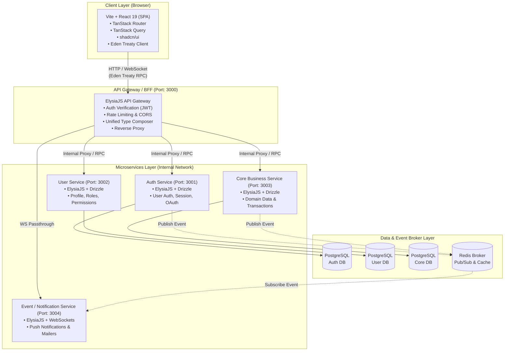

# Skema Arsitektur Microservices: Bun, ElysiaJS, & React 19 SPA

Dokumen ini menjelaskan rancangan arsitektur microservices modern yang menghubungkan client Single Page Application (SPA) berbasis Vite + React 19 + TanStack Router dengan backend layanan terdistribusi (microservices) berbasis Bun + ElysiaJS + Drizzle ORM.

---

## 1. Diagram Topologi Sistem



---

## 2. Struktur Monorepo Microservices

Pola direktori monorepo menggunakan Bun workspaces untuk mendistribusikan kontrak tipe antar-layanan:

```text
d:/srikaya/
├── apps/
│   └── web/                            # Client SPA (Vite + React 19 + TanStack Router)
│       ├── src/
│       │   ├── routes/                 # File-based routing TanStack Router
│       │   │   ├── __root.tsx          # Root layout & providers
│       │   │   ├── index.tsx           # Home page
│       │   │   ├── login.tsx           # Login page
│       │   │   └── dashboard/          # Protected area
│       │   ├── lib/
│       │   │   ├── api.ts              # Eden Treaty klien terhubung ke Gateway
│       │   │   └── query-client.ts     # Konfigurasi TanStack Query
│       │   └── components/ui/          # Komponen shadcn/ui
│       └── package.json
│
├── services/                           # Microservices Cluster (Bun + ElysiaJS)
│   ├── gateway/                        # API Gateway / Aggregator
│   │   ├── src/
│   │   │   ├── middleware/             # Verifikasi token JWT, security header
│   │   │   ├── routes/                 # Reverse proxy & rute komposit
│   │   │   └── index.ts                # Ekspor gabungan AppType untuk Eden
│   │   └── package.json
│   │
│   ├── auth/                           # Layanan Autentikasi
│   │   ├── src/
│   │   │   ├── db/                     # Drizzle schema (auth)
│   │   │   └── index.ts                # Sub-app Elysia auth
│   │   └── package.json
│   │
│   ├── user/                           # Layanan Pengguna & Profil
│   │   ├── src/
│   │   │   ├── db/                     # Drizzle schema (user)
│   │   │   └── index.ts                # Sub-app Elysia user
│   │   └── package.json
│   │
│   └── core/                           # Layanan Domain Inti
│       ├── src/
│       │   ├── db/                     # Drizzle schema (core domain)
│       │   └── index.ts                # Sub-app Elysia core
│       └── package.json
│
├── packages/
│   ├── shared-types/                   # Skema Zod & Type definitions antar-service
│   │   └── src/index.ts
│   └── config/                         # Konfigurasi ESLint, Tailwind, TS bersama
│
├── AGENTS.md
├── ARCHITECTURE.md
├── MICROSERVICES.md
└── package.json                        # Bun Workspaces manifest
```

---

## 3. Komposisi Tipe: Mempertahankan Type Safety Eden Treaty

Tantangan umum arsitektur microservices adalah hilangnya *type safety* pada sisi client. Dengan ElysiaJS, API Gateway dapat menggabungkan tipe dari seluruh microservices menjadi satu kontrak RPC terpadu:

### A. Definisi Sub-Service (Contoh: `services/user/src/index.ts`)
```typescript
import { Elysia, t } from 'elysia'

export const userService = new Elysia({ prefix: '/users' })
  .get('/profile', ({ user }) => {
    return { id: 'usr-123', name: 'Dev Srikaya', role: 'admin' }
  })
  .post('/update', ({ body }) => {
    return { success: true, updated: body }
  }, {
    body: t.Object({
      name: t.String({ minLength: 2 })
    })
  })

export type UserService = typeof userService
```

### B. Gateway Aggregator (`services/gateway/src/index.ts`)
```typescript
import { Elysia } from 'elysia'
import { cors } from '@elysiajs/cors'
import type { UserService } from 'user-service'
import type { AuthService } from 'auth-service'

// Gateway bertindak sebagai reverse proxy sekaligus penentu kontrak tipe
const app = new Elysia({ prefix: '/api' })
  .use(cors())
  // Menghubungkan routing internal via fetch/proxy
  .all('/users/*', async ({ request }) => {
    const url = new URL(request.url)
    const targetUrl = `http://localhost:3002${url.pathname}${url.search}`
    return fetch(targetUrl, {
      method: request.method,
      headers: request.headers,
      body: request.body
    })
  })

// Menggabungkan tipe kontrak untuk client
export type GatewayApp = typeof app & {
  users: UserService
  auth: AuthService
}

app.listen(3000)
console.log('API Gateway aktif pada port 3000')
```

### C. Client Eden Treaty (`apps/web/src/lib/api.ts`)
```typescript
import { treaty } from '@elysiajs/eden'
import type { GatewayApp } from 'gateway'

// Client otomatis mendapatkan autocomplete & type inference 100% dari seluruh service
export const api = treaty<GatewayApp>('localhost:3000/api')
```

---

## 4. Integrasi Client: TanStack Router + TanStack Query

Pada sisi client, data fetching dari microservices diintegrasikan langsung ke dalam router loaders:

```tsx
// apps/web/src/routes/dashboard.tsx
import { createFileRoute } from '@tanstack/react-router'
import { queryOptions, useSuspenseQuery } from '@tanstack/react-query'
import { api } from '@/lib/api'

// 1. Query options terikat Eden Treaty
const userProfileQuery = queryOptions({
  queryKey: ['user', 'profile'],
  queryFn: async () => {
    const { data, error } = await api.users.profile.get()
    if (error) throw new Error('Gagal memuat profil pengguna')
    return data
  }
})

// 2. TanStack Router Loader memastikan data siap sebelum halaman me-render
export const Route = createFileRoute('/dashboard')({
  loader: ({ context: { queryClient } }) => {
    return queryClient.ensureQueryData(userProfileQuery)
  },
  component: DashboardPage
})

function DashboardPage() {
  const { data: profile } = useSuspenseQuery(userProfileQuery)

  return (
    <div className="p-6">
      <h1 className="text-2xl font-bold">Halo, {profile.name}</h1>
      <span className="text-sm text-neutral-500">Peran: {profile.role}</span>
    </div>
  )
}
```

---

## 5. Komunikasi Antar-Microservices (Inter-Service)

1.  **Sinkron (Synchronous Request-Reply)**:
    *   Gunakan HTTP langsung antar-service internal (`http://user-service:3002`) menggunakan `fetch` bawaan Bun yang berkecepatan tinggi.
    *   Gunakan Eden Treaty internal antar-service untuk menjaga type-safety server-ke-server.
2.  **Asinkron (Event-Driven Broker)**:
    *   Gunakan **Redis Pub/Sub** atau **Redis Streams** untuk peristiwa bisnis yang tidak memerlukan respon instan (misal: `user.registered` → memicu pembuatan notifikasi selamat datang atau pengiriman surel).
3.  **Database Isolation**:
    *   Setiap service memiliki skema Drizzle tersendiri dan kredensial database terisolasi untuk memastikan prinsip *loose coupling*.

